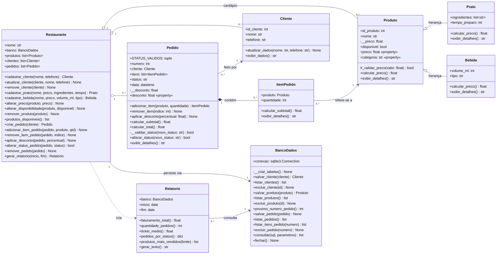
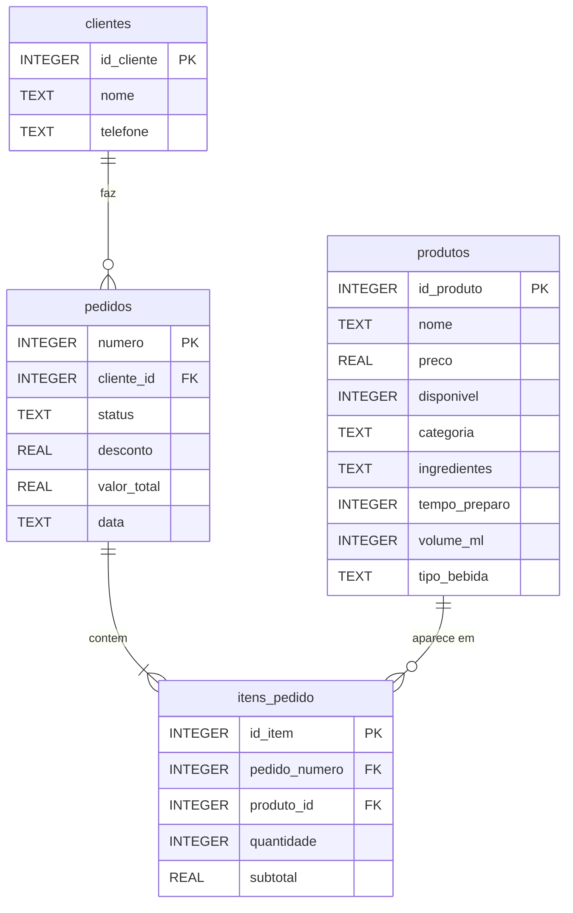

# Etapa 2 — Especificação UML e Arquitetura

## 1. Diagrama de classes

Notação de visibilidade: `+` público, `-` privado, `#` protegido.

Em Python, a convenção adotada no código é:
- `__nome` (dois sublinhados) para membros **privados**. O Python aplica
  *name mangling*, então eles não podem ser acessados de fora da classe.
- `_nome` (um sublinhado) para membros **protegidos**, de uso da classe e das filhas.

### Multiplicidades

| Associação | Multiplicidade | Significado |
|---|---|---|
| Pedido → Cliente | `0..*` para `1..1` | Todo pedido tem exatamente um cliente. Um cliente pode ter vários pedidos. |
| Pedido ◆ ItemPedido | `1..1` para `0..*` | Composição: os itens só existem dentro do pedido e são apagados junto com ele. |
| ItemPedido → Produto | `0..*` para `1..1` | Cada item referencia um produto. Um produto aparece em vários itens. |
| Restaurante ◇ Produto/Cliente/Pedido | `1..1` para `0..*` | Agregação: o restaurante mantém as coleções em memória. |
| Restaurante → BancoDados | `1..1` para `1..1` | O restaurante delega toda a persistência a um único banco. |
| Relatorio → BancoDados | `0..*` para `1..1` | Cada relatório consulta o banco ao ser gerado. |

## 2. Descrição funcional das entidades

### Produto (classe base)
Representa qualquer item do cardápio.
- `__preco` é **privado**. Só é lido e alterado pela *property* `preco`, cujo
  *setter* chama `_validar_preco()` (protegido) e rejeita valores ≤ 0,
  não numéricos ou booleanos com `ValueError`.
- `calcular_preco()` e `exibir_detalhes()` são os pontos de **polimorfismo**,
  sobrescritos nas filhas.
- `categoria` identifica o tipo concreto na hora de gravar no banco.

### Prato (herda de Produto)
Acrescenta `ingredientes` (lista de textos) e `tempo_preparo` (minutos).
Sobrescreve `exibir_detalhes()` para mostrar ingredientes e tempo, e
`calcular_preco()` como ponto de extensão (por exemplo, para uma taxa de preparo).

### Bebida (herda de Produto)
Acrescenta `volume_ml` e `tipo` (suco, refrigerante, alcoólica…). Sobrescreve
`exibir_detalhes()` para mostrar volume e tipo, e `calcular_preco()`.

### Cliente
Guarda `id_cliente`, `nome` e `telefone`. `atualizar_dados()` valida que o nome
não fique vazio. `exibir_dados()` formata o cliente para listas.

### ItemPedido
Classe de associação entre `Pedido` e `Produto`. `calcular_subtotal()` usa
`produto.calcular_preco()` vezes `quantidade`, de modo que o polimorfismo do
produto se reflete no valor. A quantidade deve ser um inteiro > 0.

### Pedido (comanda)
- `numero`, `cliente`, `itens`, `status` e `data` são públicos.
- `__desconto` é **privado**. Só muda por `aplicar_desconto()`, que aceita
  apenas 0–100%. A *property* `desconto` é somente leitura.
- `__validar_status()` é **privado**. Aceita só os valores de `STATUS_VALIDOS`
  e exige que o pedido avance no fluxo (não volta de "pronto" para "pendente").
- `alterar_status()` retorna `False` e mantém o estado anterior quando a transição é inválida.
- `calcular_subtotal()` soma os itens. `calcular_total()` aplica o desconto.

### Restaurante (Facade)
Ponto único de acesso usado pela interface. Ao ser criado, carrega produtos,
clientes e pedidos do banco e reconstrói as associações entre os objetos. Cada
operação valida as regras de negócio e grava a alteração no banco. Exemplos de
regras: só pedidos pendentes têm itens alterados, pedido vazio não avança de
status, e produto já vendido não pode ser excluído (só desativado).

### BancoDados
Encapsula a conexão `sqlite3`. `__criar_tabelas()` é **privado** e é chamado
no construtor para garantir o schema. Todas as instruções SQL são
parametrizadas (`?`), o que evita injeção de SQL. Converte linhas do banco em
objetos `Prato`, `Bebida` e `Cliente`.

### Relatorio
Recebe o banco e um período opcional (`inicio`, `fim`). Calcula com SQL
agregado (`SUM`, `COUNT`, `AVG`, `GROUP BY`) o faturamento dos pedidos
entregues, a quantidade de pedidos, o ticket médio, a contagem por status e o
ranking de produtos. `gerar_texto()` monta o relatório exibido na interface.

## 3. Entradas, saídas e persistência

### Interação pela interface gráfica

| Tela (aba) | Entradas do usuário | Método do Restaurante | Saída na tela |
|---|---|---|---|
| Clientes | Nome, telefone; seleção na lista | `cadastrar_cliente`, `atualizar_cliente`, `remover_cliente` | Lista atualizada de clientes |
| Cardápio | Categoria (Prato/Bebida), nome, preço, ingredientes/tempo ou volume/tipo | `cadastrar_prato`, `cadastrar_bebida`, `alterar_preco`, `alterar_disponibilidade`, `remover_produto` | Lista com `exibir_detalhes()` de cada produto (polimorfismo) |
| Pedidos | Cliente, produto, quantidade, desconto, novo status | `criar_pedido`, `adicionar_item_pedido`, `remover_item_pedido`, `aplicar_desconto`, `alterar_status_pedido`, `remover_pedido` | Comanda com itens, subtotal, desconto e total; lista de pedidos com status |
| Relatório | Data inicial e final (opcionais) | `gerar_relatorio` | Faturamento, ticket médio, pedidos por status, mais vendidos |

Erros de regra de negócio (preço inválido, desconto fora da faixa, status
inválido) chegam à interface como exceções ou retorno `False` e aparecem em
caixas de diálogo.

### Plano de persistência (SQLite)

**Mapeamento da herança:** `Prato` e `Bebida` ficam em uma única tabela
`produtos` (*single table inheritance*). A coluna `categoria` diz qual classe
instanciar na leitura, e as colunas específicas da outra categoria ficam `NULL`.

**Ciclo de gravação:** cada método do `Restaurante` que altera o estado chama
o `salvar_*` correspondente do `BancoDados` logo em seguida. O pedido é gravado
inteiro em uma transação (cabeçalho mais regravação dos itens), então banco e
memória nunca ficam divergentes.

**Ciclo de leitura:** na inicialização, o `Restaurante` carrega produtos e
clientes e depois reconstrói os pedidos, ligando cada `ItemPedido` ao mesmo
objeto `Produto` já carregado. Assim a identidade de objetos é preservada.
